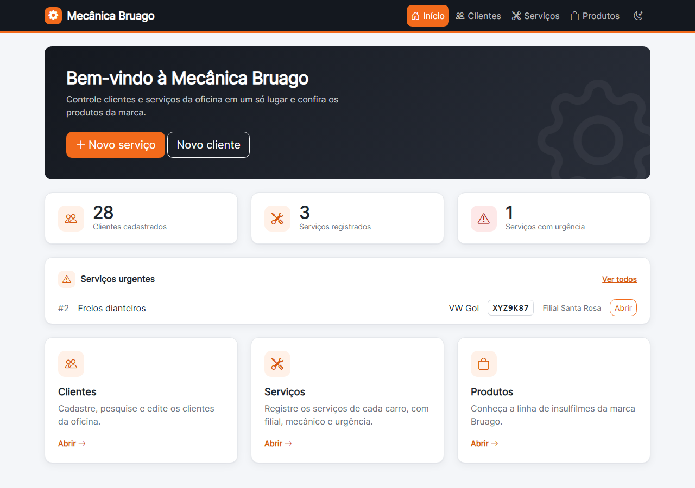
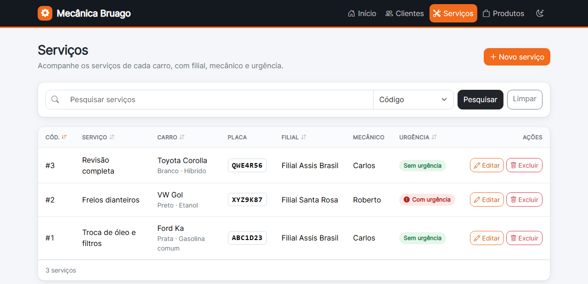
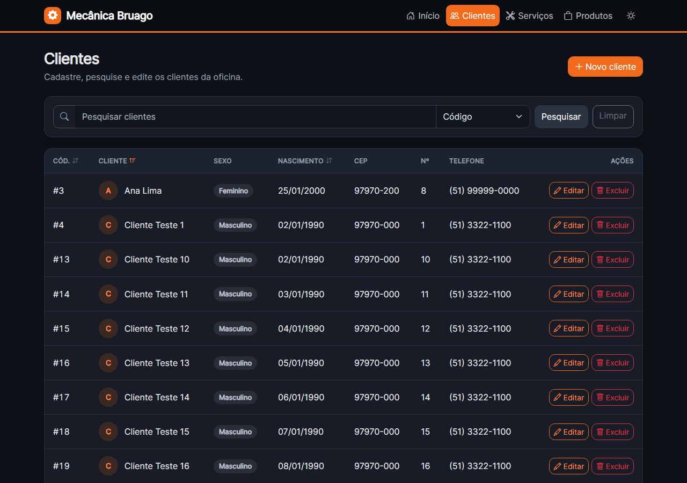
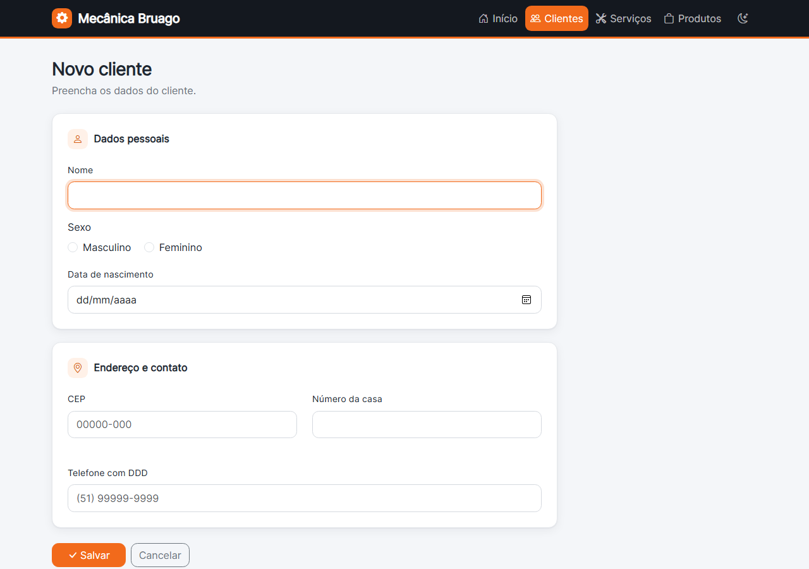
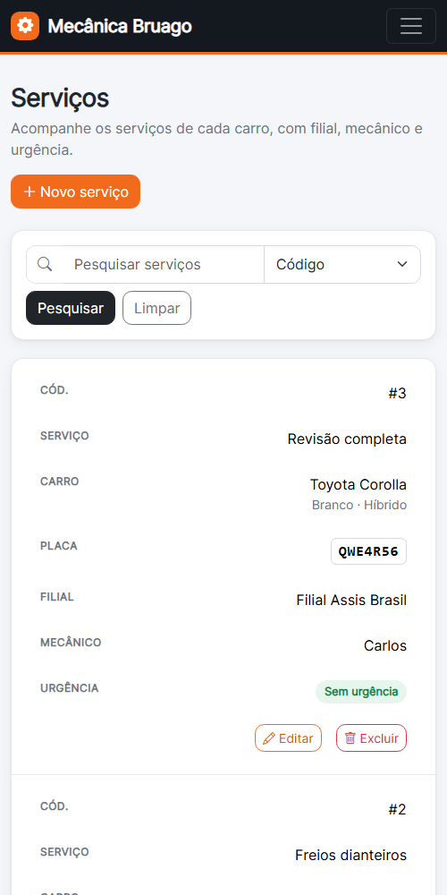

# Mecânica Bruago

Sistema web de uma oficina mecânica, com cadastro de clientes e de serviços e uma vitrine de produtos. Projeto final da disciplina Web 2 do Curso Técnico em Informática da QI, feito por Bruno Rocha e Thiago Dias e modernizado em 2026.



## O que faz

- **Painel inicial:** totais de clientes e serviços e os serviços urgentes em destaque.
- **Clientes:** cadastrar, listar, pesquisar por qualquer campo, editar e excluir.
- **Serviços:** registrar o serviço de cada carro (filial, mecânico, placa antiga ou Mercosul, combustível e urgência), com as mesmas ações.
- **Produtos:** vitrine em Vue 3 com a lista (`produtos/index.php`), uma página por produto (`produto.php?id=rodas`) e a página do carrinho (`carrinho.php`). São 4 produtos (insulfilme, rodas, óleo e palhetas), com opções de estoque e preço próprios e selo de promoção com desconto. Dá para adicionar ao carrinho ou "Comprar agora" direto no cartão da lista. O carrinho tem painel lateral rápido e uma página completa, no estilo de loja: foto, preço unitário e promoção, quantidade com +/− (limitada pelo estoque), resumo com descontos, retirada na oficina grátis e "Finalizar compra" (demonstração, sem pagamento). Fica guardado no navegador.
- **Listas:** ordenação clicando no título da coluna, paginação (10 por página) e, no celular, cada linha vira um cartão.
- **Formulários:** máscaras de telefone, CEP e placa e, ao digitar o CEP, o endereço aparece como dica (consulta a API pública [ViaCEP](https://viacep.com.br) pelo navegador; o endereço não é gravado, só o CEP).
- **Tema claro e escuro:** botão na barra superior; segue o tema do sistema na primeira visita e lembra a escolha. Também aceita `?tema=claro` ou `?tema=escuro` na URL.

### Telas

| Serviços (claro) | Clientes (escuro) |
| --- | --- |
|  |  |

| Formulário | Celular |
| --- | --- |
|  |  |

## Tecnologias

- PHP 8.2 ou mais recente (testado no 8.5), sem framework
- MySQL 8 ou MariaDB (PDO)
- Bootstrap 5, Bootstrap Icons, fonte Inter e Vue 3 pela CDN (versões fixas)

## Como rodar

1. Importe o banco: `banco/mecanica.sql` pelo phpMyAdmin ou `mysql -u root -p < banco/mecanica.sql`. Os dados de exemplo são fictícios.
2. Copie `config/config.example.php` para `config/config.php` e ajuste usuário e senha. O `config.php` não vai para o Git.
3. Suba o servidor apontando para a pasta `public/`:

   ```bash
   php -S localhost:8000 -t public
   ```

   Abra <http://localhost:8000>. No XAMPP, acesse `http://localhost/mecanica-bruago/public/`.

## Testes

```bash
php tests/executar.php
```

Os testes usam SQLite em memória (extensão `pdo_sqlite`), então não precisam do MySQL.

## Publicar em hospedagem gratuita (InfinityFree)

Testado com PHP 8.4 e MySQL no plano grátis. A hospedagem só serve a pasta `htdocs`, então a árvore do projeto vai inteira para dentro dela e um `.htaccess` na raiz manda tudo para `public/`:

```apache
Options -Indexes
RewriteEngine On
RewriteCond %{REQUEST_URI} !^/public/
RewriteRule ^(.*)$ public/$1 [L]
```

1. No painel, crie um banco MySQL e importe o `banco/mecanica.sql` pelo phpMyAdmin **sem as linhas `CREATE DATABASE` e `USE`** (a hospedagem já cria o banco e o nome dele tem prefixo da conta).
2. Envie por FTP, para dentro de `htdocs`, as pastas `public/`, `src/` e `templates/` e o `.htaccess` acima (arquivo oculto: ative "mostrar arquivos ocultos" no cliente de FTP).
3. Crie `htdocs/config/config.php` **direto no servidor**, com o host, o usuário, o nome do banco e a senha que o painel mostra (formato do `config/config.example.php`). Nunca versione esse arquivo.
4. Se não souber a versão do PHP da conta, envie um arquivo temporário com `<?php echo PHP_VERSION;` e apague-o depois. O projeto precisa do PHP 8.2 ou mais novo.

> **Atenção:** enquanto não houver login, as telas de clientes e serviços ficam abertas para qualquer pessoa na internet (criar, editar e excluir). Use só dados fictícios.
## Estrutura

```text
public/            # única pasta exposta ao navegador
├── index.php
├── clientes/      # index.php (lista e pesquisa), formulario.php (novo e editar), excluir.php
├── servicos/      # mesmas páginas para serviços
├── produtos/      # index.php (lista) e produto.php (um produto); catálogo, carrinho e painel lateral em loja.js
├── css/           # estilo.css (tema claro e escuro)
└── js/            # tema, máscaras, busca de CEP e confirmação de exclusão
src/               # classes (namespace Mecanica\, autoload em src/bootstrap.php)
├── Banco/         # Conexao (PDO)
├── Modelo/        # Cliente, Servico e enums (Sexo, Filial, Combustivel, Urgencia)
├── Repositorio/   # consultas SQL, sempre parametrizadas
├── Validacao/     # regras e normalização dos formulários
└── Web/           # Html (escape e formatação), Listagem (ordem e página na URL) e Pagina (redirecionar, avisos, CSRF)
templates/         # cabeçalho, rodapé e paginação compartilhados
docs/imagens/      # prints usados no README
config/            # config.example.php (modelo da conexão)
banco/             # script do MySQL
tests/             # testes sem dependências
```

## Segurança

- Consultas com parâmetros (sem SQL injection) e lista fixa de colunas pesquisáveis.
- Todo texto mostrado passa por `htmlspecialchars` (sem XSS).
- Formulários com token CSRF; excluir só por POST, com confirmação.
- Senha do banco fora do repositório.
- Ordem e direção da lista só aceitam valores de uma lista fixa (nunca vão direto para o SQL).

## Próximos passos

1. **Login de administrador:** proteger clientes, serviços e o painel (senha com `password_hash`, sessão segura, primeiro admin criado por script local, sem senha padrão no código).
2. **Cadastro aberto de clientes e pedido de serviço:** qualquer pessoa cria conta (papel sempre "cliente", definido no servidor), liga a conta ao cadastro de cliente que já existe e pede serviços que o admin acompanha.
3. **Loja de verdade:** salvar os pedidos no banco (hoje o "Finalizar compra" é só demonstração e o carrinho fica no navegador).
4. **Versão em Laravel** (branch ou repositório separado) com o e-commerce completo, reaproveitando banco, visual e catálogo. Esta versão em PHP puro continua como o projeto base.
5. **Limpar o histórico do Git:** os primeiros commits ainda têm o `mecanica.sql` antigo com dados pessoais; remover exige reescrever o histórico.
## Fotos

As fotos de rodas, óleo (Ipiranga F1 Master) e palhetas, em `public/produtos/imagens/`, foram fornecidas pelo autor do projeto; as marcas e imagens pertencem aos respectivos donos. Se for publicar o projeto de forma comercial, troque por fotos próprias ou com licença.

## Licença

[MIT](LICENSE)
